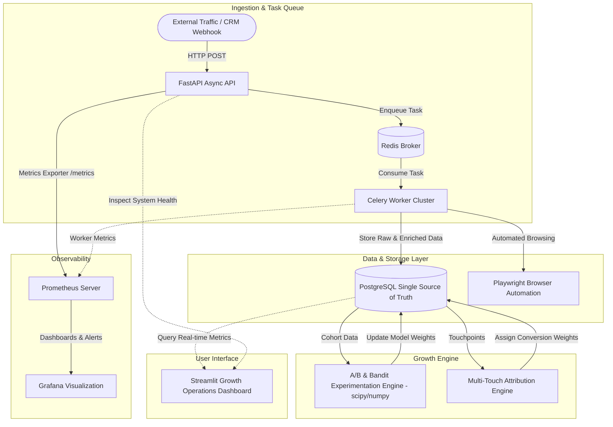

# JurisFlow

> **Enterprise-grade growth engineering infrastructure simulating B2B SaaS outbound automation, lead enrichment, experimentation, and multi-touch attribution.**

[](LICENSE)
[](https://www.python.org/)
[](https://fastapi.tiangolo.com/)
[](https://www.postgresql.org/)
[](https://docs.celeryq.dev/)
[](https://redis.io/)
[](https://playwright.dev/)
[](https://www.docker.com/)

---

## Overview

**JurisFlow** is a portfolio-grade backend and data engineering system designed to simulate the growth and revenue operations infrastructure of a modern B2B SaaS organization. It emphasizes code quality, resilience, asynchronous processing, failure isolation, and rigorous observability.

Rather than fragmenting data across multiple specialized engines, JurisFlow establishes PostgreSQL as the single, authoritative source of truth across transactional and analytical workloads, combining high-throughput async processing with resilient background workers and comprehensive metric instrumentation.

---

## Architecture



---

## Key Capabilities

1. **Lead Enrichment Pipeline**: Ingests prospect domain and profile data, triggering asynchronous background workers that enrich profiles via external data integration and structured parsing.
2. **Rate-Limited Outbound Automation**: Employs Playwright for headless browser automation with jitter, exponential backoff, and distributed rate limiting to safely interact with CRM targets.
3. **Statistical Experimentation Engine**: Uses `scipy` and `numpy` to implement hypothesis testing (A/B testing via two-sample z/t-tests) and dynamic traffic allocation via Multi-Armed Bandits (Thompson Sampling and Upper Confidence Bound).
4. **Multi-Touch Attribution**: Evaluates conversion paths using first-touch, last-touch, linear, time-decay, and position-based attribution models directly within PostgreSQL.
5. **Full Observability Stack**: Exposes system metrics via Prometheus and visualizes API latency, task queue depth, worker throughput, and error rates in Grafana.
6. **Real-time Operations Dashboard**: Interactive Streamlit interface to inspect experiment status, attribution reports, and lead queues.

---

## Tech Stack

| Domain | Technology | Description |
| :--- | :--- | :--- |
| **Backend API** | FastAPI (Python 3.11+) | Asynchronous ASGI REST API framework with native Pydantic validation |
| **Task Queue** | Celery + Redis | Distributed asynchronous task execution, scheduled jobs, and rate-limiting |
| **Database** | PostgreSQL 15 | Single source of truth for transactional records, queues, and analytics |
| **ORM & Migrations** | SQLAlchemy 2.0 (Async) + Alembic | Fully asynchronous database operations with typed migrations |
| **Automation** | Playwright (Python) | Headless browser execution for outbound automation workflows |
| **Statistics** | SciPy + NumPy | Frequentist and Bayesian experimentation algorithms |
| **UI Dashboard** | Streamlit | Python-native growth engineering and operations interface |
| **Observability** | Prometheus + Grafana | Metrics collection, threshold alerting, and visual dashboards |
| **Testing** | Pytest + Pytest-Asyncio + HTTPX | Integration testing with real database fixtures (no mocking DB calls) |
| **Orchestration** | Docker Compose | One-command multi-service environment (`docker-compose up`) |

---

## Repository Structure

```text
JurisFlow/
├── app/                  # FastAPI Application
│   ├── main.py           # Application entrypoint, middleware, health endpoints
│   ├── routers/          # API route definitions
│   ├── models/           # SQLAlchemy 2.0 async declarative models
│   ├── schemas/          # Pydantic v2 validation schemas
│   └── services/         # Core business logic services
├── workers/              # Celery task execution
│   └── celery_app.py     # Celery instance configuration & task routes
├── dashboard/            # Streamlit dashboard
│   └── app.py            # Growth operations UI
├── tests/                # Automated test suite
│   └── test_health.py    # Health check and endpoint tests
├── alembic/              # Database migration scripts
│   ├── env.py            # Async migration runner
│   └── versions/         # Revision files
├── docs/                 # System documentation
│   ├── architecture.md   # Architectural overview and Mermaid diagram
│   ├── decisions.md      # Architectural Decision Records (ADRs)
│   └── README.md         # Docs index
├── docker-compose.yml    # Service orchestration (7 services)
├── Dockerfile            # Container definition
├── pyproject.toml        # Project dependencies and packaging
├── prometheus.yml        # Prometheus metric scrape targets
├── .env.example          # Environment variable template
├── .gitignore            # Git exclusions
└── LICENSE               # MIT License
```

---

## Getting Started

### Prerequisites
- [Docker Desktop](https://www.docker.com/products/docker-desktop/) (running with Linux containers / WSL2)
- [Git](https://git-scm.com/)

### 1. Clone & Setup
```bash
git clone https://github.com/kirtishukla9955/JurisFlow.git
cd JurisFlow
cp .env.example .env
```

### 2. Boot the Entire System
Launch all 7 services in isolated containers:
```bash
docker-compose up --build -d
```

Verify service health:
```bash
docker-compose ps
```

All services will show `(healthy)`:
- **FastAPI**: [http://localhost:8000/health](http://localhost:8000/health) (Docs: [http://localhost:8000/docs](http://localhost:8000/docs))
- **Streamlit Dashboard**: [http://localhost:8501](http://localhost:8501)
- **Prometheus**: [http://localhost:9090](http://localhost:9090)
- **Grafana**: [http://localhost:3000](http://localhost:3000) (User: `admin` / Password: `admin`)
- **PostgreSQL**: `localhost:5432` (`jurisflow` / `password`)
- **Redis**: `localhost:6379`

---

## Database Migrations

JurisFlow utilizes asynchronous Alembic migrations backed by SQLAlchemy 2.0 and `asyncpg`.

Run migrations inside the running API container:
```bash
docker-compose exec api alembic upgrade head
```

Create a new migration revision:
```bash
docker-compose exec api alembic revision --autogenerate -m "describe_changes"
```

---

## Testing

Run unit and integration tests against the live test database container:
```bash
docker-compose exec api pytest
```

---

## Design Decisions

See [docs/decisions.md](docs/decisions.md) for detailed Architectural Decision Records (ADRs), including:
- **ADR-001**: Single Database Setup (PostgreSQL-only) versus Multi-database polyglot architectures.

---

## License

This project is licensed under the [MIT License](LICENSE) © 2026 Kirti Shukla.
